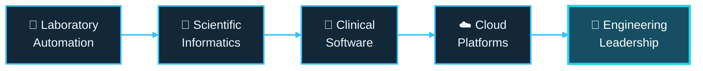

# Andrew Carretta 👨‍💻

---

### 👋 About Me

I'm an engineering leader and hands-on technologist with over 15 years of experience designing and delivering software at the intersection of **science, automation, and regulated clinical operations**.

My experience spans laboratory robotics, scientific informatics, LIMS, clinical software, cloud infrastructure, and engineering leadership. I enjoy solving complex problems, developing scalable platforms, and turning ambitious technical ideas into reliable, maintainable solutions.

### 🚀 My Engineering Journey

### ⚡ Areas of Focus

- 🧬 **Scientific & Clinical Software** LIMS, informatics, clinical workflows, and data integration
- 🤖 **Laboratory Automation** robotics, instrument integration, and workflow orchestration
- ☁️ **Cloud Architecture** scalable infrastructure, platform engineering, and reliable operations
- 🛡️ **Regulated Software** security, compliance, auditability, and quality
- 🚀 **Engineering Leadership** technical strategy, architecture, product development, and engineering practices
- 🧠 **Applied AI** exploring practical AI applications across scientific and clinical systems
